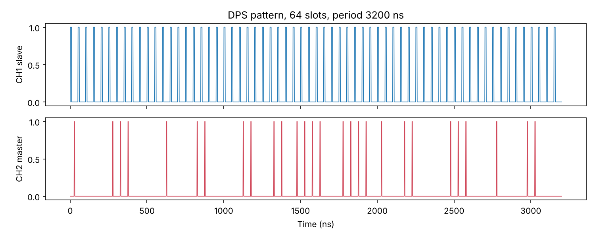

# Stage 4: QKD

Turn the locked pulse train into protocol patterns, then measure QBER and visibility with single-photon detectors.

| Script | Does |
|---|---|
| `qkd_patterns.py cow\|dps\|bb84` | Random-bit AWG files for CH1 (slave) and CH2 (master steps), plus `sent.csv`, the record of what was sent |
| `timetag_qber.py` | Folds time-tagger detections onto the pattern: COW data-line QBER and monitor visibility; DPS QBER from interferometer ports |
| `keyrate.py` | Expected detection rate, QBER and decoy-BB84 secure key rate against fibre length for the bench parameters |

Needed hardware (to borrow): Si SPADs, a time tagger, a one-slot delay-line interferometer (50 ns slots = ~10 m fibre delay, or shorter slots with a shorter delay), attenuation to ~0.1–0.5 photons per pulse, and 852 nm single-mode fibre spools.

Limitations to be aware of:
- The AWG repeats its file, so the bits repeat. Fine for QBER and visibility tests; a real key needs a non-repeating source.
- The BB84 step-to-phase mapping in `oil852/patterns.py` is a placeholder until the phase per volt of master step is calibrated.
- COW and DPS security proofs are protocol-specific; `keyrate.py` uses decoy BB84 as the benchmark.

Try it without hardware: `python 04_qkd/timetag_qber.py --demo dps`

