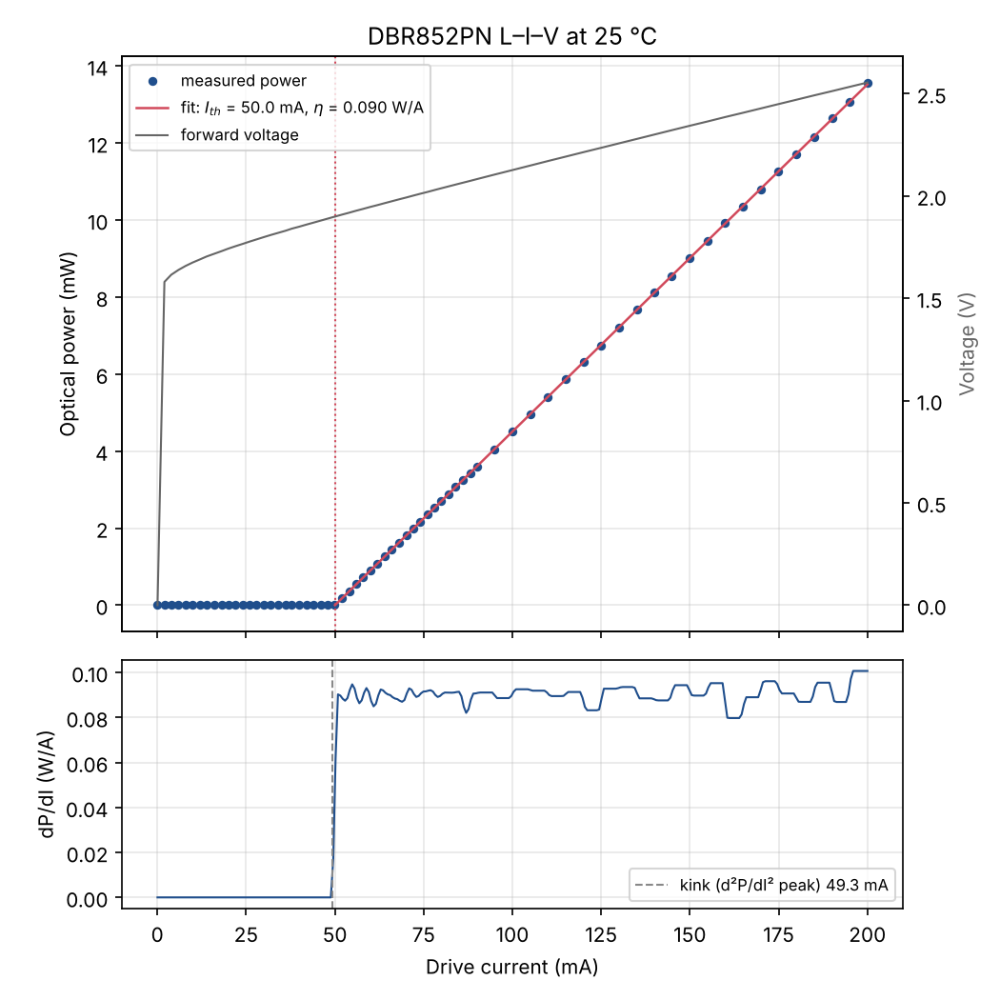
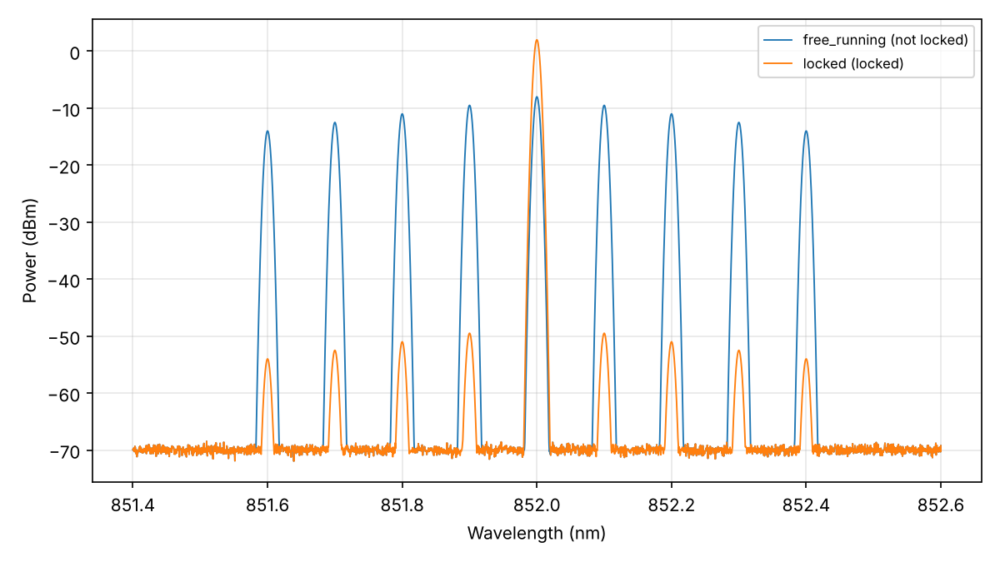
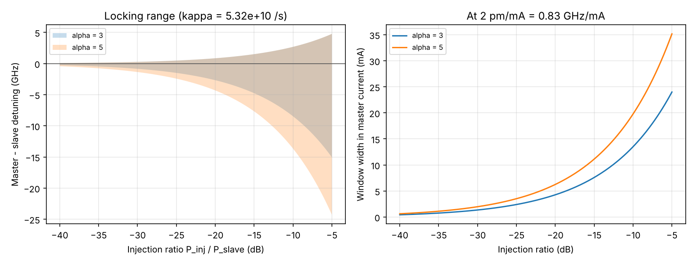
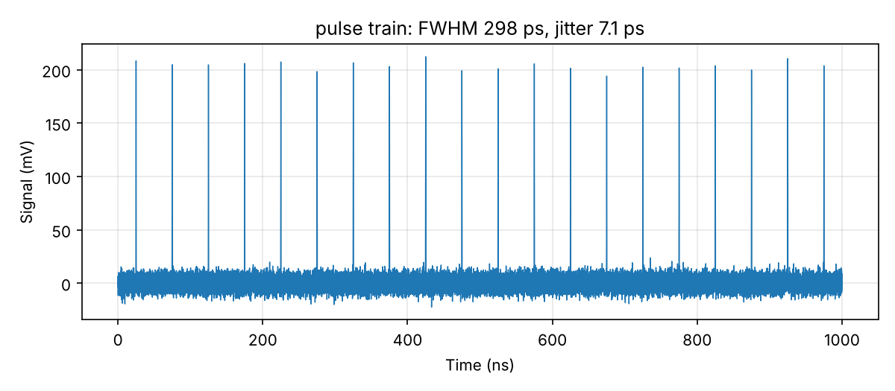
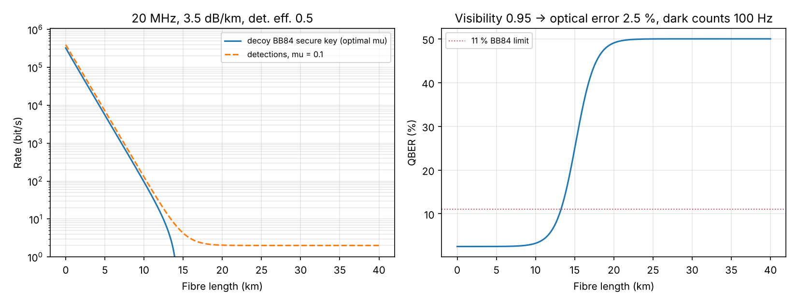

# Optical Injection Locking QKD Transmitter — 5th Year MPhys Project

**A modulator-free, optically injection-locked 852 nm transmitter for quantum key distribution: from laser characterisation to QKD**

Todd Blacklaw — Heriot-Watt University, MPhys Physics, Year 5

*Supervisor: Dr Ross Donaldson, Institute of Photonics and Quantum Sciences*

---

## Overview

This repository holds the code, bench documentation and data for my masters project. The project builds a QKD transmitter in which a gain-switched **slave** laser is injection-locked to a continuous **master** laser. Locking gives every slave pulse the master's phase, so small current steps on the master between pulses encode phase without an external modulator. That one source can produce the pulse trains for COW, DPS and phase-encoded BB84.

The project started with a monolithic OIL photonic integrated circuit on loan from the University of Glasgow, and a carrier PCB designed for it. When the loaned packages turned out to be damaged, the transmitter was rebuilt from discrete parts at 852 nm so every element can be driven and measured separately. The longer-term direction is fibre deployment, then an airborne platform, then the satellite context of the group's Hub Optical Ground Station and the SPOQC CubeSat programme. See [docs/project_history.md](docs/project_history.md).

The work is split into four stages, each a folder of scripts that share the `oil852` package:

1. **Characterisation** — each laser alone: L–I–V, threshold against temperature, wavelength tuning, stability.
2. **Injection locking** — VOA calibration, OSA spectra, where and how strongly the slave locks against injection ratio.
3. **Pulsed operation** — gain switching through a bias tee, master phase steps, pulse width and jitter.
4. **QKD** — protocol drive patterns, QBER and visibility from time-tagged detections, expected key rates.

> **Status (Oct 2026):** stage 1 is ready for the bench (DBR852PN master first). Stages 2–4 are written and tested against simulated data and wait on hardware: a ≥ 1 A driver for the slave, OSA access, then SPADs and a time tagger. Every figure below marked *simulated* comes from the built-in simulator, not from measurements; they will be replaced by real data as it comes in.

---

## The bench

```
                       VOA (0-5 V)        99:1 B            PM circulator
 DBR852PN master ──────[ V800PA ]──────[  1% tap  ]────► 1 ──────► 2 ◄────► FPL852P slave
 KLD101 + TTC001                            │                       │          KLD-class ≥1 A driver
                                            ▼                       ▼          + bias tee ◄── AWG CH1 (pulses)
                                       injection power         3 ──► 99:1 A ──► output
                                                                       │
                                                       1% tap ──► power meter / OSA / fast photodiode / SPADs
```

| Laser | Role | Threshold | Slope | Power | Driver |
|---|---|---|---|---|---|
| DBR852PN (852 nm DBR) | Master, CW, single-frequency | ~50 mA | 0.09 W/A | 24 mW at 300 mA | KLD101 (max 230 mA) |
| FPL852P (852 nm Fabry–Perot) | Slave, gain-switched | 200–300 mA | 0.51 W/A | 300 mW at 900 mA | needs ≥ 1 A |

Full instrument list, connections and how data reaches the laptop: [docs/instruments_and_data.md](docs/instruments_and_data.md). Wiring: [docs/wiring.md](docs/wiring.md). Settings for a first run: [docs/bench_settings.md](docs/bench_settings.md). Safety: [docs/safety.md](docs/safety.md).

---

## Repository Structure

```
5th-year-project--OIL/
│
├── README.md
├── requirements.txt
├── config/
│   └── bench.toml                 ← serial numbers, addresses, per-laser current limits, fibre/detector numbers
│
├── oil852/                        ← shared package
│   ├── instruments/               ← KLD101 (Kinesis DLL), PM100D, AWG-5064, Tek scope, simulated + manual stand-ins
│   ├── analysis.py                ← threshold, slope, series resistance, T0, tuning, mode hops
│   ├── spectrum.py                ← OSA traces: peaks, SMSR, mode spacing, locked or not
│   ├── locking.py                 ← locking range, GHz <-> pm <-> mA conversions
│   ├── pulses.py                  ← pulse width, jitter, extinction
│   ├── patterns.py                ← COW / DPS / BB84 drive patterns and AWG files
│   ├── qkd.py                     ← transmittance, QBER, decoy-BB84 key rate
│   └── bench.py, runio.py, ...    ← safety limits, ramping, run folders
│
├── 01_characterisation/           ← L-I-V, temperature series, stability, wavelength tuning
├── 02_injection_locking/          ← VOA calibration, OSA analysis, locking map, locking theory
├── 03_pulsed/                     ← AWG patterns (proven double-pulse setup), waveform files, scope capture
├── 04_qkd/                        ← protocol patterns, time-tag QBER/visibility, key rate vs distance
│
├── docs/
│   ├── bench_settings.md          ← driver/TEC/meter settings, switch-on order, what to expect
│   ├── instruments_and_data.md    ← every instrument, its connection and software
│   ├── wiring.md                  ← butterfly pinout, driver and Arroyo adapters, RF and fibre paths
│   ├── theory.md                  ← OIL, locking range, gain switching, protocols, key-rate formula
│   ├── safety.md
│   ├── project_history.md         ← PIC phase, PCB, discrete rebuild, stage status
│   └── img/
├── hardware/                      ← kit list; pcb/ for the KiCad carrier board
├── tests/                         ← pytest checks against simulated data
└── data/                          ← one folder per measurement run
```

---

## Stage 1 — Characterisation

`li_sweep.py` steps the master's current through the KLD101, reads the PM100D at every point and fits the threshold (two methods), slope efficiency and series resistance. Repeating it at several TEC temperatures gives the characteristic temperature T0. `wavelength_log.py` records the peak wavelength from the OSA and fits the tuning coefficients, which become the map for steering the master onto a slave mode in stage 2.



*Simulated DBR852PN. Measured results will be tabulated here.*

| Quantity | Spec sheet | Measured |
|---|---|---|
| Threshold (25 °C) | ~50 mA | — |
| Slope efficiency | 0.09 W/A | — |
| Power at 200 mA | ~13.5 mW | — |
| Current tuning | ~2 pm/mA | — |
| Temperature tuning | ~0.06 nm/°C | — |

---

## Stage 2 — Injection locking

The free-running FP slave shows a comb of modes about 0.1 nm apart. When the master is tuned onto one of them with enough injected power, the comb collapses to a single line at the master wavelength. `locking_map.py` steps the master current and records lock and SMSR at each point; `locking_theory.py` compares the measured windows with the textbook range, which grows as √(injection ratio).

At 852 nm, 1 pm ≈ 0.41 GHz and the master tunes ≈ 0.83 GHz per mA, so a locking range of a few GHz is only a few mA of master current.




---

## Stage 3 — Pulsed operation

The AWG-5064 drives the slave with 10 ns pulses every 50 ns through a bias tee on top of a DC bias just below threshold, and puts ±5 ns steps on the master in the gaps. The double-pulse configuration in `awg_oil_patterns.py` has been verified on the scope into 50 Ω. `scope_capture.py` measures pulse width, timing jitter and extinction from repeated single shots.



---

## Stage 4 — QKD

`qkd_patterns.py` turns random bits into CH1/CH2 waveform files for COW, DPS or BB84 and records what was sent. `timetag_qber.py` folds time-tagged detections onto that record to give the COW data-line QBER and monitoring visibility, or the DPS QBER. `keyrate.py` gives the expected detection rate, QBER and decoy-state BB84 key rate against fibre length.



With 852 nm single-mode fibre at ~3.5 dB/km, a 50 % efficient Si SPAD and 20 MHz pulses, the model gives ~140 kbit/s at 1 km and no key beyond ~14 km. That is why 852 nm suits free-space and satellite links better than long fibre, which ties back to the 4th-year FSO work.

---

## Getting Started

```bash
git clone https://github.com/Toddb2/5th-year-project--OIL.git
cd 5th-year-project--OIL
python -m venv .venv
.venv\Scripts\activate          # Windows; source .venv/bin/activate elsewhere
pip install -r requirements.txt
```

Try everything without hardware:

```bash
python 01_characterisation/li_sweep.py --temp 25 --mode sim
python 02_injection_locking/osa_spectrum.py --demo
python 02_injection_locking/locking_map.py --temp 25 --slave-mA 400 --voa-dB 20 --currents 80:200:1 --mode sim
python 03_pulsed/scope_capture.py --mode sim
python 04_qkd/timetag_qber.py --demo dps
python 04_qkd/keyrate.py --spools 1 5 10
pytest
```

On the bench (Windows, Kinesis and NI-VISA installed, serial numbers in `config/bench.toml`):

```bash
python 01_characterisation/check_instruments.py
python 01_characterisation/li_sweep.py --temp 25 --stop 200 --zero
```

If the KLD101 won't connect, add `--mode manual-driver` (you set each current; the script still reads the meter).

---

## Safety built into the code

Per-laser current limits in `config/bench.toml`; refusal to run the FP slave on the 230 mA KLD101; driver polarity and mode checks before switching on; ramped current changes; abort on sensor overload or a current mismatch (open circuit); automatic ramp-down and disable at the end, on error or on Ctrl+C; AWG levels capped from the config; VOA control limited to 5 V.

---

## Dependencies

| Package | Purpose |
|---|---|
| numpy, scipy, pandas | Numerics, fitting, data handling |
| matplotlib | Plots |
| pyvisa | PM100D, AWG-5064 and Tek scope (NI-VISA on Windows; `pyvisa-py` elsewhere) |
| Thorlabs Kinesis | KLD101 laser drivers (Windows DLL, called through `ctypes`) |
| pytest | Tests |

---

## Related Repositories

- [4th-year-project---KORUZA-FSO-QKD](https://github.com/Toddb2/4th-year-project---KORUZA-FSO-QKD) — low-cost FSO terminal and BB84 modelling under Scottish atmospheric conditions.
- `qkd-noise-study` — combined FSO channel and quantum-hardware noise for BB84, B92 and BBM92.

---

## Acknowledgements

Thanks to Dr Ross Donaldson (Heriot-Watt University) for supervision, to the group at the Institute of Photonics and Quantum Sciences for equipment and advice, and to the University of Glasgow team who developed and loaned the original monolithic OIL transmitter.

KLD101 control follows Thorlabs' published Kinesis examples (`Thorlabs/Motion_Control_Examples`).

---

## Licence

Code is MIT licensed. Documentation and data are copyright Todd Blacklaw, Heriot-Watt University, 2026.
